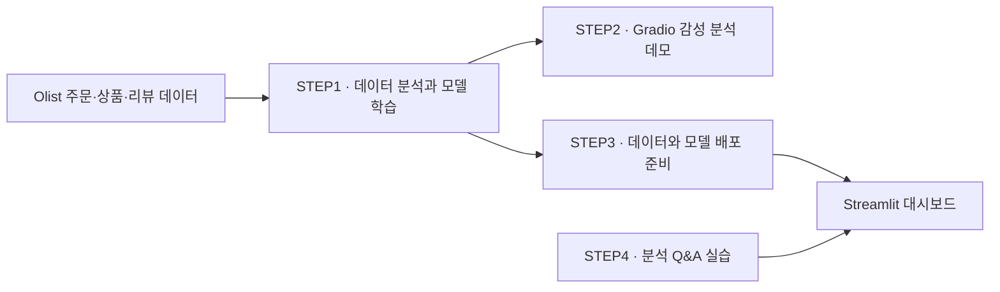
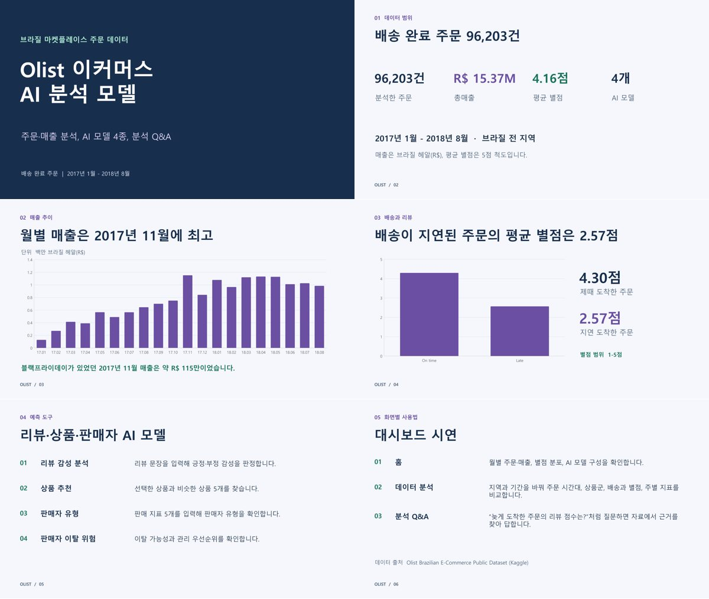

# 📦 Olist 이커머스 AI 분석 모델

브라질 온라인 마켓플레이스 **Olist**의 주문 데이터로 매출과 배송, 고객 리뷰를 분석하고, 학습한 **AI 모델 4종**을 Streamlit에서 실행하는 프로젝트입니다. 분석 Q&A에서는 프로젝트 자료를 찾아 근거와 함께 답변을 확인할 수 있습니다.

> 대시보드부터 써 보려면 [로컬 실행](#로컬-실행)으로, 분석 과정부터 따라가려면 [실습 순서](#실습-순서)로 이동하세요.

---

## 🗺️ 프로젝트 흐름



<a id="실습-순서"></a>

### 실습 순서

| 단계 | 실습 내용 | 시작 파일 |
| --- | --- | --- |
| **STEP1** | 주문과 상품 데이터를 연결해 탐색하고, 추천·감성 분석·판매자 모델을 학습합니다. | [탐색적 데이터 분석 노트북](STEP1_Model_Training/05_eda.ipynb) |
| **STEP2** | Gradio에서 리뷰 문장을 입력하고 감성 분석 결과를 확인합니다. | [감성 분석 데모 노트북](STEP2_Model_Serving/01_sentiment_demo_gradio.ipynb) |
| **STEP3** | 대시보드에서 읽을 주문·상품 데이터와 학습 모델을 준비합니다. | [배포 파일 준비 노트북](STEP3_Local_Deploy/00_prepare_deploy_files.ipynb) |
| **STEP4** | 질문과 관련된 자료를 검색하고, 근거 ID를 붙여 답하는 챗봇을 실습합니다. | [분석 Q&A 노트북](STEP4_RAG_Chatbot/11_olist_rag_chatbot.ipynb) |

STEP1을 처음부터 재현하려면 [노트북 폴더](STEP1_Model_Training)에서 번호 순서대로 진행하세요. 탐색적 데이터 분석 전에 04번 노트북으로 통합 데이터를 준비하고, 데모와 배포 파일을 직접 만들 때는 필요한 학습 모델을 먼저 저장합니다.

---

## 📊 데이터 범위와 분석 결과

대시보드는 **2017년 1월~2018년 8월 배송 완료 주문**을 집계합니다. 주문과 상품은 `order_id`로 연결되며, 한 주문에 상품이 여러 개 포함될 수 있습니다. 주문 수는 주문 단위로, 상품군 매출은 주문에 포함된 상품 단위로 확인합니다.

| 분석한 주문 | 총매출 | 평균 별점 |
| ---: | ---: | ---: |
| 96,203건 | R$ 1,537만 | 4.16점 / 5점 |

- **월별 매출**은 2017년 11월에 약 R$ 115만으로 가장 높았습니다.
- **배송과 별점**을 비교하면 제때 도착한 주문의 평균은 4.30점, 지연된 주문은 2.57점이었습니다.

---

## 🖥️ 대시보드 화면

| 화면 | 할 수 있는 일 |
| --- | --- |
| 홈 | 월별 주문과 매출, 별점 분포, AI 모델 구성을 확인합니다. |
| 데&#8288;이&#8288;터&nbsp;분&#8288;석 | 지역과 기간을 골라 월별 실적, 주문 시간대, 상품군 매출, 배송과 별점, 브라질 주별 지표를 비교합니다. 필터를 적용한 주문 데이터는 CSV로 내려받을 수 있습니다. |
| 리&#8288;뷰&nbsp;감&#8288;성&nbsp;분&#8288;석 | 포르투갈어 리뷰 문장을 입력해 긍정·부정 감성을 확인합니다. |
| 상&#8288;품&nbsp;추&#8288;천 | 상품을 고르면 비슷한 상품 5개를 보여 줍니다. |
| 판&#8288;매&#8288;자&nbsp;유&#8288;형 | 판매 지표 5개를 입력해 네 가지 판매자 유형 중 어디에 해당하는지 확인합니다. |
| 판&#8288;매&#8288;자&nbsp;이&#8288;탈&nbsp;위&#8288;험 | 판매자별 이탈 가능성과 관리 우선순위를 확인합니다. |
| 분&#8288;석&nbsp;Q&#8288;&amp;&#8288;A | 분석 자료를 검색해 답변과 근거 ID를 확인합니다. OpenAI API 키가 필요합니다. |

### AI 모델과 파일

| 모델 | 학습 노트북 | 웹앱에서 읽는 파일 |
| --- | --- | --- |
| 리뷰 감성 분석 | `07_1_sentiment_ml` | `part7_1_sentiment_ml.pkl` |
| 상품 추천 | `06_recommendation` | `part6_recommend.pkl` |
| 판매자 유형 | `08_seller_segment` | `part8_seller_segment.pkl` |
| 판매자 이탈 위험 | `09_seller_churn` | `part9_seller_churn.pkl`, `seller_table.csv` |

### 분석 Q&A 채널

| 채널 | 검색 자료 | 질문 예시 |
| --- | --- | --- |
| A. 분석 사실 확인 | 분석 사실표 | 늦게 도착한 주문의 평균 별점은 얼마인가요? |
| B. 분석 + 모델 안내 | 사실표와 모델 설명서 | 이탈 모델은 어떤 지표를 사용하나요? |
| C. 분석 + 모델 + 규정 | 사실표, 모델 설명서, 판매자 규정집 | 출고 기한은 어떻게 되나요? |

---

<a id="로컬-실행"></a>

## 🚀 로컬 실행

**1. 저장소를 내려받고 앱 폴더로 이동합니다.**

```bash
git clone https://github.com/sinyoungk0711-droid/Olist_Data_Analysis.git
cd Olist_Data_Analysis/STEP3_Local_Deploy/olist_dashboard
```

**2. Python 3.12 가상환경을 만듭니다.**

Windows PowerShell

```powershell
py -3.12 -m venv .venv
.\.venv\Scripts\Activate.ps1
```

macOS 또는 Linux

```bash
python3.12 -m venv .venv
source .venv/bin/activate
```

**3. 의존성을 설치하고 앱을 실행합니다.**

```bash
python -m pip install -r requirements.txt "streamlit==1.67.0"
python -m streamlit run app.py
```

브라우저에서 [localhost:8501](http://localhost:8501)을 엽니다. 모델 파일은 의존성 목록의 scikit-learn 1.6.1을 사용하며, Streamlit은 홈 차트와 아이콘을 확인한 버전으로 지정합니다.

**4. 분석 Q&A를 사용하려면 자료 위치와 API 키를 확인합니다.**

현재 분석 Q&A 코드는 앱의 `data/`에서 자료를 읽습니다. 앱의 `rag/`에 있는 사실표, 모델 설명서, 규정집 PDF를 `data/`에 복사한 뒤, 왼쪽 입력 칸에 OpenAI API 키를 넣으세요. 환경 변수 `OPENAI_API_KEY`나 로컬 `.streamlit/secrets.toml`에 키를 설정해도 됩니다. API 키는 저장소에 올리지 마세요.

---

## 📁 저장소 구성

```text
Olist_Data_Analysis/
├── STEP1_Model_Training/       데이터 탐색과 모델 학습
├── STEP2_Model_Serving/        Gradio 감성 분석 데모
├── STEP3_Local_Deploy/
│   └── olist_dashboard/       Streamlit 앱
│       ├── app.py              앱 시작과 페이지 메뉴
│       ├── views/              홈, 데이터 분석, 모델, 분석 Q&A
│       ├── utils/              데이터 처리, 모델 예측, 자료 검색
│       └── requirements.txt    설치 목록
├── STEP4_RAG_Chatbot/          분석 Q&A 노트북
└── docs/                      발표자료 PDF와 미리보기
```

**사용 기술** · pandas, PyArrow, Plotly, scikit-learn, Gradio, Streamlit, LangChain, OpenAI API

---

## 발표자료

[Olist 이커머스 AI 분석 모델 발표자료 (PDF)](docs/Olist_AI_Analysis.pdf)



| 슬라이드 | 주요 내용 |
| --- | --- |
| 1. 프로젝트 소개 | 브라질 Olist 주문 데이터를 분석하고 AI 모델 4종과 분석 Q&A를 제공하는 대시보드 |
| 2. 데이터 범위 | 2017년 1월~2018년 8월 배송 완료 주문 96,203건, 총매출 R$ 1,537만, 평균 별점 4.16점 |
| 3. 월별 매출 | 2017년 11월이 가장 높았으며, 해당 월 매출은 약 R$ 115만 |
| 4. 배송과 별점 | 제때 도착한 주문의 평균은 4.30점, 지연된 주문의 평균은 2.57점 |
| 5. AI 모델 4종 | 리뷰 감성 분석, 상품 추천, 판매자 유형 분류, 판매자 이탈 위험 예측 |
| 6. 대시보드 시연 | 홈에서 핵심 지표를 보고, 데이터 분석에서 지역·기간을 비교하고, 분석 Q&A에서 근거를 찾아 답변 확인 |

---

## 📌 데이터 출처

[Brazilian E-Commerce Public Dataset by Olist](https://www.kaggle.com/datasets/olistbr/brazilian-ecommerce) (Kaggle)
